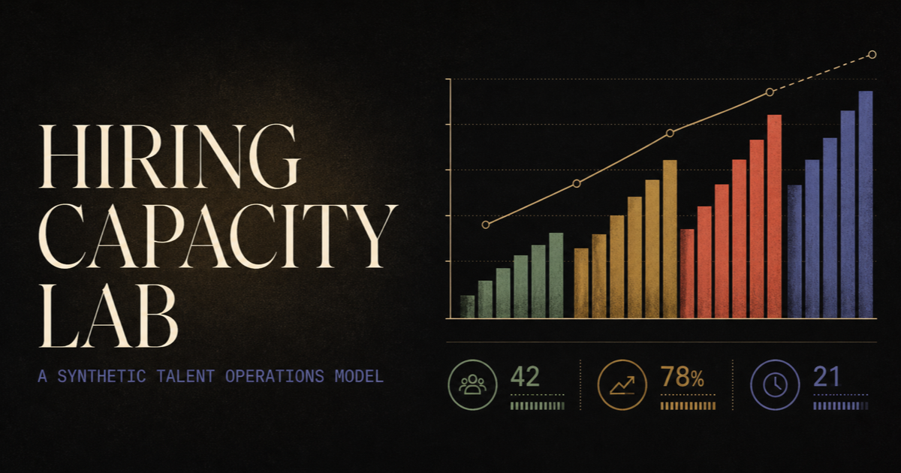

# Hiring Capacity Lab

An interactive, public portfolio project that models what happens when hiring
demand grows faster than recruiting throughput.



## Why this exists

Hiring plans are usually discussed as counts: approved roles, open positions,
and completed hires. Capacity problems appear when those counts are treated in
isolation. Hiring Capacity Lab puts demand, throughput, and accumulated backlog
into one operating model, then lets the viewer change the assumptions.

The project is designed to demonstrate:

- executive data storytelling;
- product thinking applied to talent operations;
- responsive and accessible data visualization;
- a small interactive forecasting model; and
- careful public-data hygiene.

## Important data note

Every organization reference, figure, label, threshold, and narrative in this
repository was created specifically for this public demonstration. The project
does not contain, transform, or approximate an employer dataset. See
[PUBLIC_DATA_AND_PRIVACY.md](PUBLIC_DATA_AND_PRIVACY.md) for the release policy.

## Product tour

1. **Overview** frames the operating question and summarizes the synthetic
   demand-to-capacity gap.
2. **Demand** compares monthly requested and approved headcount.
3. **Capacity** places technical hiring demand beside completed hires.
4. **Scenario Lab** lets the viewer adjust demand, throughput, backlog, and
   forecast horizon.
5. **Decision Guide** connects model thresholds to practical operating moves.

## Technology

- React 19 and TypeScript
- Next.js 16 application structure
- CSS-native responsive charts with semantic table equivalents
- Vinext/Vite build support for Cloudflare-compatible output
- No database, authentication, analytics, or third-party data services

The charts intentionally do not depend on a charting library. This keeps the
bundle smaller, removes container-measurement race conditions, and makes the
underlying values easy to expose to assistive technology.

## Run locally

Requires Node.js 22.13 or newer.

```bash
npm ci
npm run dev
```

Open the local URL printed by the development server.

## Validate

```bash
npm run lint
npm test
```

`npm test` creates the production build and verifies the server-rendered public
experience. A standard Next.js build is also available for hosting providers
that expect it:

```bash
npm run build:next
```

## Project structure

```text
app/
  capacity-lab.tsx   Interactive product and accessible chart components
  data.ts            Entirely synthetic public dataset
  globals.css        Visual system and responsive behavior
  layout.tsx         Public metadata and social preview configuration
  page.tsx           Route entry point
public/
  favicon.png        Project favicon
  og.png             1200 × 630 social-preview image
tests/
  rendered-html.test.mjs
```

## License

MIT © 2026 Tristan Couvares. See [LICENSE](LICENSE).
